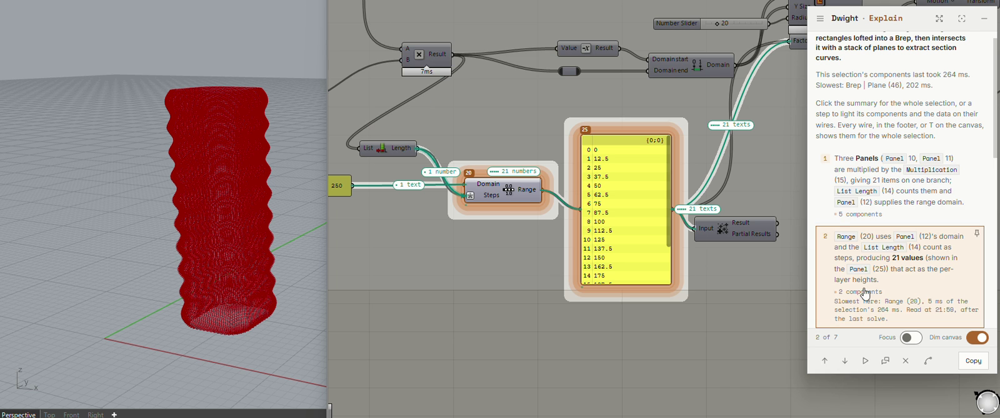
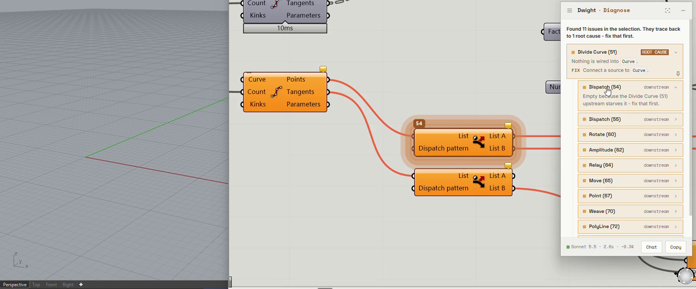
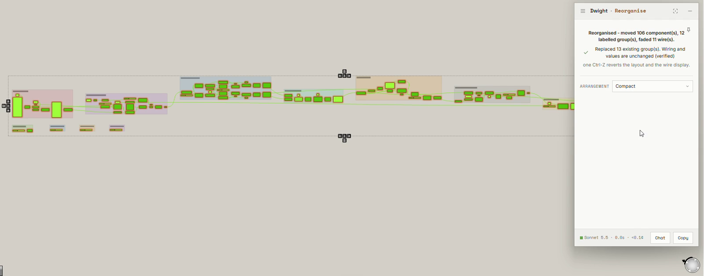
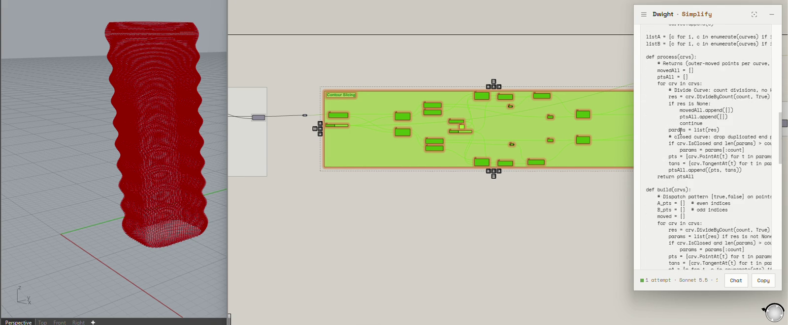
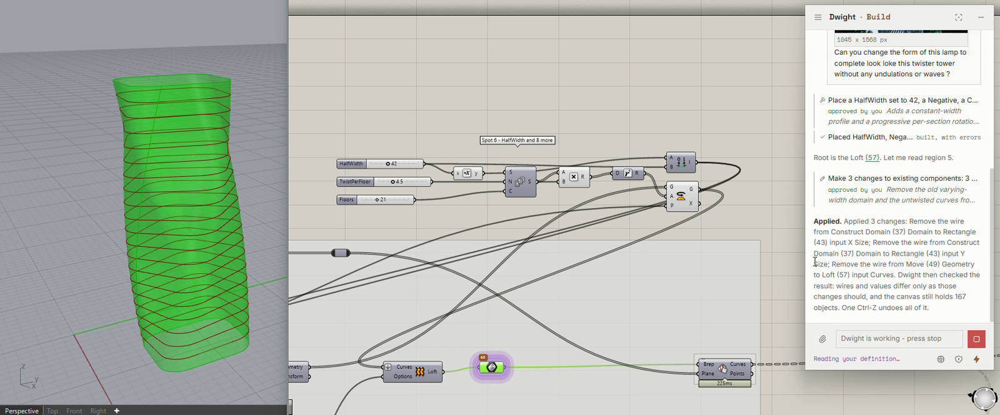

# Dwight

Dwight is a [Grasshopper](https://www.rhino3d.com/features/#grasshopper) plugin for Rhino 8 that adds five tools to the canvas: Explain, Diagnose, Reorganise, Simplify and Build. Select components, press **Ctrl+Shift+Right-click**, and pick a tool. Each tool does its exact work in code and uses a language model for the one part that needs judgement, on your own API key or fully local with Ollama.

The plugin computes every id, coordinate and check. Every change to your definition sits behind a consent card and one Ctrl-Z; Full control, off by default, is the one exception. Open source, Apache 2.0.

[](https://dwight.tha.run/)

The picture opens [dwight.tha.run](https://dwight.tha.run/), where the film of the five tools plays.

> **Status: released, version 1.0.2 (8 November 2026).** Windows and Rhino 8.24 or later. Rhino 7 is not supported. Known limits, including that converting to a script is experimental and that a build on a local model may time out, are in [`docs/public/known-limitations.md`](docs/public/known-limitations.md).

## The five tools

| Tool | The question it answers |
| --- | --- |
| **Explain** | "What does this do?" A walk on the canvas, one step at a time, or a detailed or short answer, foregrounding the data-tree structure on your wires. Learn makes it a deck of quiz cards that take you round the canvas. |
| **Diagnose** | "Why is this broken or empty?" A deterministic fault scan that traces each fault to its root cause, then explains it. Changes nothing. |
| **Reorganise** | "Clean this up so I can read it." Regions found from the wiring, named, grouped and laid out. Never changes logic: a behaviour fingerprint is checked before the layout is kept. |
| **Simplify** | "Make this better or smaller." Better logic as a selectable set of verified changes, or collapse the selection into one C# or Python script (experimental). Always shown to you first. |
| **Build** | "Help me build or extend this." A conversation that reads your definition, plans regions, builds and rebuilds them with a verdict on every change, changes one slider or panel, rewires or deletes existing components you tick, and edits one script, each behind a consent card and one Ctrl-Z. |

The read-only tools (Explain, Diagnose) are always safe to reach for. Detail is in [`docs/public/verbs.md`](docs/public/verbs.md) and [`docs/public/build.md`](docs/public/build.md).

## What each tool looks like

**Explain**



Step by step on a lamp definition, on step 2 of 7: Range (20) makes the lamp's 21 layer heights, lit on the canvas with what travels on its wires (21 numbers), and the panel says the selection's components last took 264 ms.

**Diagnose**



"Found 11 issues in the selection. They trace back to 1 root cause": Divide Curve (51), with nothing wired into its Curve input, and the fix, with the issues it causes downstream listed under it; it changes nothing.

**Reorganise**



"Reorganised - moved 106 component(s), 12 labelled group(s), faded 11 wire(s)": it replaced 13 existing groups, "Wiring and values are unchanged (verified)", and one Ctrl-Z reverts the layout and the wire display.

**Simplify**



To a script: Simplify writes the lamp's contour slicing as one Python 3 component and shows you the whole source; nothing changes until you accept.

**Build**



The chat after two cards, each approved by you: nine components placed as Spot 6, then three wires removed, and Dwight's report of what it applied and checked: "the canvas still holds 167 objects. One Ctrl-Z undoes all of it."

## Install

1. Windows and Rhino 8.24 or later. Rhino 7 and macOS are not supported.
2. Install **Dwight** from Rhino's package manager (`_PackageManager`), or download a release and copy `Dwight.gha` and the DLLs beside it into `%APPDATA%\Grasshopper\Libraries\Dwight\`.
3. Restart Rhino, open Grasshopper, choose **Dwight > Settings...**, pick a provider and paste your key.

Full steps: [`docs/public/install.md`](docs/public/install.md). What changed in each version: [`docs/public/changelog.md`](docs/public/changelog.md).

## Providers and keys

Anthropic, OpenAI, Google, and Ollama (local, or Ollama Cloud). You bring the key: create one in your provider's account console, then paste it in **Dwight > Settings...**. Keys are stored in the Windows Credential Manager, never in plaintext. With Ollama running locally, nothing leaves your machine unless you turn on web search. Build needs a model that can drive tools and runs on all five; on Ollama local it reads a definition, and its one measured build timed out on the test machine. The other four tools are not tied to any one provider. See [`docs/public/providers-and-keys.md`](docs/public/providers-and-keys.md).

## Privacy

Dwight sends data from your machine to the model provider you chose, using your key, and to nobody else. What each verb and each chat tool sends is a table in the source ([`Dwight/Data/PayloadContract.cs`](Dwight/Data/PayloadContract.cs)), checked by tests, and written out in [`docs/public/privacy.md`](docs/public/privacy.md). In short: Explain and Reorganise send structure (component types, wires, tree signatures), not values or geometry; Simplify's logic mode adds the source of any script component; Diagnose also forwards Grasshopper's own error text verbatim; converting to a script sends the constant values it needs.

## How it works

The governing rule: **the language model supplies semantic judgement; the plugin computes all structure and geometry.** Every id, coordinate, bound, segmentation and validation is deterministic C#. The plugin builds an internal graph of your selection with short-integer ids, projects a task-specific payload from it, sends that over HTTPS with your key, validates what comes back against the graph before showing or applying anything, and discards the graph afterwards.

## Build and test

Requires the .NET SDK pinned in [`global.json`](global.json) (the plugin targets `net7.0-windows`) and, to run it, Rhino 8.24 or later. The headless test projects need no Rhino.

```
dotnet build Dwight.sln -p:CI=true    # builds everything without touching your Grasshopper install
dotnet test  Dwight.sln               # all eight headless test projects
```

A plain `dotnet build` also copies `Dwight.gha` and its dependency DLLs into `%APPDATA%\Grasshopper\Libraries\Dwight\`; close Rhino first so the copy can land. See [`CONTRIBUTING.md`](CONTRIBUTING.md) for the CI gates and the rules a change follows.

## Reporting a problem

Open an issue using the bug template. For a security problem, do not open an issue: see [`SECURITY.md`](SECURITY.md).

## Contributing

Read [`CONTRIBUTING.md`](CONTRIBUTING.md) first. Everyone taking part follows the [Code of Conduct](CODE_OF_CONDUCT.md).

## Licence and credits

[Apache 2.0](LICENSE), copyright 2026 Tharun Eswar. Third-party libraries, fonts and services are listed in [`NOTICE.md`](NOTICE.md).
